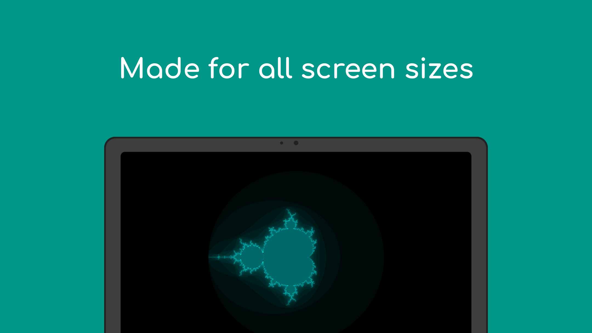
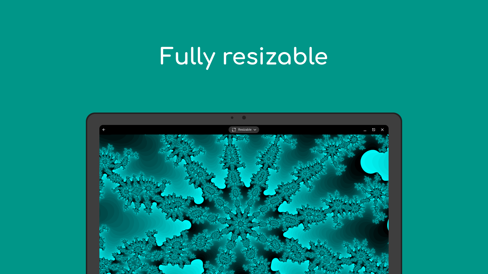

<div align="center">
  <h1>Fractal Viewer</h1>
  <h3>Real-Time GPU-Accelerated Fractal Explorer</h3>
  Explore Mandelbrot, Julia, Burning Ship, Tricorn, Multibrot-3, and Celtic sets beyond 10<sup>300</sup>&times; zoom with Material 3 eXtended (<code>m3x</code>) UI
  <br>
  <!-- Badges -->
  <a href="https://github.com/Puzzaks/fractals/releases"></a>
  <a href="https://github.com/Puzzaks/fractals/blob/main/LICENSE"></a>
  <a href="https://github.com/Puzzaks/fractals/actions/workflows/ci.yml"></a>
  <br>
  <!-- Download Buttons -->
  <a href="https://play.google.com/store/apps/details?id=page.puzzak.fractals"></a>
  <a href="https://github.com/Puzzaks/fractals/releases/latest"></a>
  <br>
  <!-- Hero Screenshot -->
  
</div>

<br>

> Hardware-accelerated complex dynamics in your pocket and on your desktop — free, offline, and open source.

---

### Features
- **Hybrid GPU Perturbation + CPU Precision Pipeline**:
  - **Real-Time GLSL Fragment Shader (`shaders/fractal.frag`)**: Renders interactively at 60–120+ FPS using native `float32` (`GPU f32`), automatically escalating to **Dekker-Knuth `df64` double-float emulation** (`GPU df64`, `zoom >= 5e4`) up to ~`10¹²×` (`2e12` scale) without CPU bottlenecks.
  - **GPU Perturbation Theory & Series Approximation (`shaders/perturbation.frag`, `lib/engine/perturbation_solver.dart`)**: Beyond `df64` precision (`zoom >= 2e12` past `10³⁰⁰×`), `Auto` and `GPU Shader` modes compute a `608+`-bit `BigFixed` reference orbit and 3-term Series Approximation in a background isolate, uploading a 48-bit `hi + lo` (`256×256`, `16,384` iterations) orbit texture with Zhuoran's rebasing (`GPU PT`) for sharp ultra-deep zooms.
  - **Persistent Multi-Isolate CPU `float64` Engine (`lib/engine/cpu_renderer.dart`)**: Interleaved worker-isolate `float64` renderer (`CPU f64`) with 1:1 formula and palette parity for manual `CPU Float64` mode and high-resolution image exports.
  - **Quality, LOD & Iteration Controls**: Four presets — `Performance (0.5x)`, `Balanced (0.75x)`, `Native (1x)`, and `Ultra (SSAA)` (`1.5×` scale + `2×2` rotated-grid supersampling in GLSL) — paired with **Auto-Adaptive Progressive LOD**, `Auto Iterations` (`80..16,384`) or manual control (`50..16,384`), Brent periodicity checking, and cardioid/period-2 bulb early bailout.
- **6 Mathematical Fractals**:
  - **Mandelbrot** ($z_{n+1} = z_n^2 + c$)
  - **Julia** ($z_{n+1} = z_n^2 + c$ with interactive `Re(c)` and `Im(c)` parameter sliders)
  - **Burning Ship** ($z_{n+1} = (|\text{Re}(z_n)| + i|\text{Im}(z_n)|)^2 + c$)
  - **Tricorn** (Mandelbar, $z_{n+1} = \overline{z_n}^2 + c$)
  - **Multibrot-3** ($z_{n+1} = z_n^3 + c$)
  - **Celtic**
- **8 Smooth Continuous Color Palettes**:
  - **System Dynamic** (inherits Material You primary & secondary colors from the OS theme), **Inferno**, **Viridis**, **Ocean**, **Neon**, **Monochrome**, **Twilight**, and **Ukraine**.
  - Cyclic 4-stop smoothstep gradients and cosine ramps prevent wrap-around color seams, with toggleable continuous log-log **Smooth Coloring** and a live **Color Phase Shift** slider.
- **Curated Landmarks, Bookmarks & Deep-Link / QR Sharing**:
  - Jump straight into 14 built-in mathematical landmarks (`assets/bookmarks.json`, updated OTA in release builds) or save custom coordinate + rotation + palette bookmarks persisted via `SharedPreferences` and Android Auto Backup.
  - Share any fractal location via scannable QR codes (`qr_flutter`) or deep links (`https://fractals.puzzak.page/v?d=...` and `fractals://v?d=...`, plus Android Recents link sharing and Play Install Referrer support) with incoming shared-bookmark preview & save.
- **MP4 Zoom Video & 8K Image Export**:
  - **MP4 Zoom Video Export**: Render `720p`, `1080p`, or `4K` videos (`3–30s`, `12–120fps`) via GPU Perturbation (`10³⁰⁰×` sharp) and Android `MediaCodec` + `MediaMuxer`, featuring a Google Photos-style filmstrip range trimmer, live preview scrubbing, and foreground-service background export (`ExportForegroundService`) saving to `/Movies/Fractals`.
  - **PNG / JPEG Image Export**: Cinebench-style live tile-rendered snapshots in `Device Screen`, `1080p`, `2K (1440p)`, `4K (2160p)`, and `8K (4320p)` with customizable aspect ratios (`Match Screen`, `16:9`, `2:1`, `21:9`, `32:9`, `4:3`, `1:1`, `Custom Size`), orientation, and rotation presets.
- **Potatoemeter Benchmark & Google Play Games Services**:
  - Deterministic GPU fence-synced **Potatoemeter** hardware benchmark (`lib/engine/potato_benchmark.dart`) scoring `GPU f32`, `GPU df64`, and `CPU f64` throughput across 6 tiers (`Raw Spud` to `Quantum Yam`).
  - **Google Play Games Services v2** (`lib/engine/play_games_service.dart`) with 3 global leaderboards (Potatoemeter Global Ranking, Deepest Zoom Reached, Total Exploration Time), 14 achievements, and cross-device progress sync.
- **Adaptive `m3x` Material 3 Expressive UI**:
  - Powered by `m3x`, `m3x_ui`, `m3x_core`, `m3x_dict`, and `m3x_gh`: features a 3-state viewport (Fullscreen via long-press, Framed Card HUD, and Adaptive Split Settings / docked side inspector on tablets, foldables, and desktops).
  - Compact zoom/position HUD with one-tap coordinate copying, magnetic axis/rotation snapping, and debug-only render telemetry (`FPS`, frame time sparkline, active engine badge).
  - Bundled **English (`en`)** and **Ukrainian (`uk`)** translations with OTA GitHub updates plus an in-app GitHub Repository Explorer.

### Controls & Shortcuts
- **Touch**: Drag for 1:1 panning, pinch to zoom anchored at the focal midpoint, two-finger twist to rotate, double-tap to zoom in, long-press to toggle fullscreen.
- **Mouse**: Drag to pan, scroll wheel to zoom smoothly toward the pointer location.
- **Keyboard** *(customizable in settings)*:
  - `+` / `-`: Zoom in / out
  - `Arrow keys` / `W` `A` `S` `D`: Pan camera
  - `Q` / `E`: Rotate canvas left / right
  - `R`: Reset camera to default fractal view
  - `H`: Show / hide HUD
  - `I`: Toggle inspector panel

### Architecture Overview
| Component | Path | Role |
| :--- | :--- | :--- |
| **GLSL Shader** | [`shaders/fractal.frag`](shaders/fractal.frag) | `#version 460 core` fragment shader (`f32`, Dekker-Knuth `df64`, `2x2` SSAA, rotation, 8 cyclic palettes, 6 fractals) |
| **Perturbation Shader** | [`shaders/perturbation.frag`](shaders/perturbation.frag) | GPU Perturbation Theory + 48-bit orbit texture & 3-term Series Approximation shader (`10³⁰⁰+×` zoom) |
| **Perturbation & BigFloat** | [`lib/engine/perturbation_solver.dart`](lib/engine/perturbation_solver.dart), [`lib/engine/big_float.dart`](lib/engine/big_float.dart) | `608+`-bit `BigFixed` arithmetic and background-isolate reference orbit + Series Approximation solver |
| **Interactive Viewport** | [`lib/widgets/fractal_canvas.dart`](lib/widgets/fractal_canvas.dart) | `FractalCanvas` GPU/PT/CPU painter, progressive LOD crossfades, gestures, wheel zoom, keyboard shortcuts |
| **State & Camera Engine** | [`lib/engine/fractal_engine.dart`](lib/engine/fractal_engine.dart) | `ChangeNotifier` state machine, `BigFixed` focal-point camera math, persistence, `Dictionary` & `AnalyticsService` |
| **Models & Landmarks** | [`lib/engine/fractal_models.dart`](lib/engine/fractal_models.dart) | `FractalType`, `FractalPalette`, `RenderQuality`, `RenderBackend`, `splitDoubleToDf64`, `FractalBookmark` |
| **Parallel CPU Renderer** | [`lib/engine/cpu_renderer.dart`](lib/engine/cpu_renderer.dart) | Persistent interleaved worker-isolate `float64` renderer for manual `CPU f64` mode and PNG/JPEG export |
| **Benchmark, Play Games & Share** | [`lib/engine/potato_benchmark.dart`](lib/engine/potato_benchmark.dart), [`lib/engine/play_games_service.dart`](lib/engine/play_games_service.dart), [`lib/engine/fractal_share_link.dart`](lib/engine/fractal_share_link.dart) | Potatoemeter hardware benchmark, Play Games Services v2 leaderboards/achievements, and deep-link/QR codec |

### Building Locally
Requires Flutter (`SDK >=3.5.0 <4.0.0`).

```bash
flutter pub get
flutter test
flutter run
```

To build release artifacts (`Fractals_v1.0.7_GitHub.apk` and `Fractals_v1.0.7_PlayStore.aab`) on Windows:

```powershell
.\build_releases.ps1          # Build both APK and AAB into build/
.\build_releases.ps1 -ApkOnly # Build only the GitHub APK
.\build_releases.ps1 -AabOnly # Build only the Play Store AAB
```

*(Note: Release builds automatically use `android/app/key.properties` when present and fall back cleanly to debug signing for local/CI builds without a keystore.)*

### Screenshots
   
   

### Resources
- **Changelog**: [Full version history](CHANGELOG.md)
- **Roadmap**: [Planned features & milestones](ROADMAP.md)
- **Play Store Metadata**: [Store listing copy](docs/PLAY_STORE_LISTING.md)
- **License**: [The Unlicense](LICENSE)

---

### Community Bookmarks
- Discovered a great location? Submit your favorite fractal coordinates via a Pull Request to [`assets/bookmarks.json`](assets/bookmarks.json) with your name in the `"author"` field.
- Release builds automatically sync updated default bookmarks over-the-air (OTA) from GitHub.

### Contributing
- Found a bug, rendering edge case, or shader optimization? Open an issue or pull request on [GitHub](https://github.com/Puzzaks/fractals/issues).
- Contributions adding new fractals, color palettes, or translations (`assets/translations/`) are welcome!

### Credits
- Built with [Flutter](https://flutter.dev/) and the [`m3x`](https://github.com/Puzzaks/m3x) Material 3 eXtended package ecosystem.
- [Google Antigravity](https://antigravity.google/) for AI reviews and suggestions during development.
- And to the Armed Forces of Ukraine for keeping me safe. [Stand with Ukraine](https://war.ukraine.ua/support-ukraine/)!
