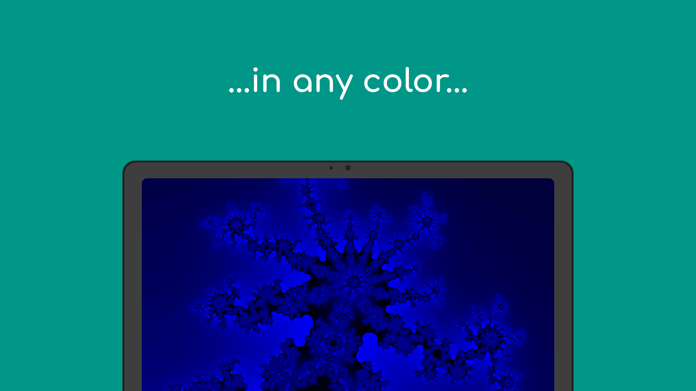
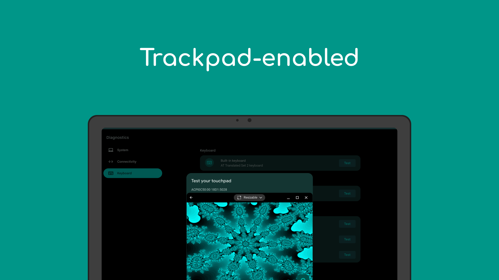
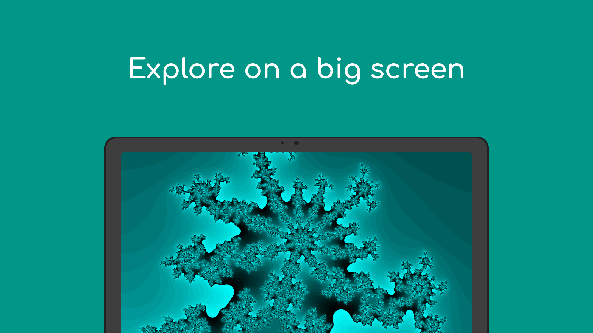

<div align="center">
  <h1>Fractal Viewer</h1>
  <h3>Real-Time GPU-Accelerated Fractal Explorer</h3>
  Explore Mandelbrot, Julia, Burning Ship, and Tricorn sets at up to 10<sup>15</sup>&times; zoom with Material 3 eXtended (<code>m3x</code>) UI
  <br>
  <!-- Badges -->
  <a href="https://github.com/Puzzaks/fractals/releases"></a>
  <a href="https://github.com/Puzzaks/fractals/blob/main/LICENSE"></a>
  <a href="https://github.com/Puzzaks/fractals/actions/workflows/ci.yml"></a>
  <br>
  <!-- Download Buttons -->
  <a href="https://play.google.com/store/apps/details?id=page.puzzak.fractals"></a>
  <a href="https://github.com/Puzzaks/fractals/releases/latest"></a>
  <br>
  <!-- Hero Screenshot -->
  
</div>

<br>

> Hardware-accelerated complex dynamics in your pocket and on your desktop — free, offline, and open source.

---

### Features
- **Hybrid GPU + CPU Precision Pipeline**:
  - **Real-Time GLSL Fragment Shader (`shaders/fractal.frag`)**: Renders interactively at 60–120+ FPS using native `float32` (`GPU f32`), automatically escalating to **Dekker-Knuth `df64` double-float emulation** (`GPU df64`, `zoom >= 5e4`) up to ~`10^12×` (`2e12` scale) without CPU bottlenecks.
  - **Seamless Multi-Isolate CPU `float64` Deep-Zoom Fallback (`lib/engine/cpu_renderer.dart`)**: Beyond GPU `df64` precision (`zoom >= 2e12` up to `10^15×`), `Auto` mode seamlessly transitions to parallel Dart worker isolates (`CPU f64`, up to 8 scanline strips via `Isolate.run`) with 1:1 formula and palette parity. Manual `Auto`, `GPU Shader`, and `CPU Float64` overrides are also available.
  - **Quality & Iteration Controls**: Four presets — `Performance (0.5x)`, `Balanced (0.75x)`, `Native (1x)`, and `Ultra (SSAA)` (`1.5×` scale + 2×2 rotated-grid supersampling in GLSL) — paired with logarithmic `Auto Iterations` (`80..2000`) or manual control (`50..2000`) and cardioid/period-2 bulb early bailout.
- **4 Mathematical Fractals**:
  - **Mandelbrot** ($z_{n+1} = z_n^2 + c$)
  - **Julia** ($z_{n+1} = z_n^2 + c$ with interactive `Re(c)` and `Im(c)` parameter sliders)
  - **Burning Ship** ($z_{n+1} = (|\text{Re}(z_n)| + i|\text{Im}(z_n)|)^2 + c$)
  - **Tricorn** (Mandelbar, $z_{n+1} = \overline{z_n}^2 + c$)
- **7 Smooth Continuous Color Palettes**:
  - **System Dynamic** (inherits Material You primary & secondary colors from the OS theme), **Inferno**, **Viridis**, **Ocean**, **Neon**, **Monochrome**, and **Twilight**.
  - Cyclic 4-stop smoothstep gradients and cosine ramps prevent wrap-around color seams, with toggleable continuous log-log **Smooth Coloring** and a live **Color Phase Shift** slider.
- **Curated Landmarks & Persistent Bookmarks**:
  - Jump straight into 9 built-in mathematical landmarks (`Mandelbrot Overview`, `Seahorse Valley`, `Elephant Valley`, `Mini-Brot Island`, `Triple Spiral`, `Burning Ship Armada`, `Julia Dendrite`, `Julia Spiral Galaxy`, `Tricorn Spire`) or save custom coordinate + palette bookmarks persisted via `SharedPreferences`.
- **HD / 2K / 4K PNG Export**:
  - Render and share crisp off-screen snapshots in **Current Screen (HD)**, **2K (`2560px`)**, and **4K (`3840px`)** PNG via `CpuFractalRenderer`.
- **Adaptive `m3x` Material 3 Expressive UI**:
  - Powered by `m3x_ui`, `m3x_core`, `m3x_dict`, and `m3x_gh`: uses a modal bottom-sheet inspector on phones and a docked side inspector on tablets, foldables, and desktops.
  - Live telemetry HUD showing rolling-average FPS, frame time sparkline, active engine badge (`GPU f32` / `GPU df64` / `CPU f64`), zoom level, iteration count, and copyable zoom-matched precision coordinates.
  - Bundled **English (`en`)** and **Ukrainian (`uk`)** translations plus an in-app GitHub Repository Explorer.

### Controls & Shortcuts
- **Touch**: Drag for 1:1 panning, pinch to zoom anchored at the focal midpoint, double-tap to zoom in.
- **Mouse**: Drag to pan, scroll wheel to zoom smoothly toward the pointer location.
- **Keyboard**:
  - `+` / `-`: Zoom in / out
  - `Arrow keys` / `W` `A` `S` `D`: Pan camera
  - `R`: Reset camera to default fractal view
  - `H`: Show / hide telemetry HUD
  - `I`: Toggle inspector panel

### Architecture Overview
| Component | Path | Role |
| :--- | :--- | :--- |
| **GLSL Shader** | [`shaders/fractal.frag`](shaders/fractal.frag) | `#version 460 core` fragment shader (`f32`, Dekker-Knuth `df64`, `2x2` SSAA, 7 cyclic palettes) |
| **Interactive Viewport** | [`lib/widgets/fractal_canvas.dart`](lib/widgets/fractal_canvas.dart) | `FractalCanvas` GPU shader & progressive CPU `float64` painter, gestures, wheel zoom, keyboard shortcuts |
| **State & Camera Engine** | [`lib/engine/fractal_engine.dart`](lib/engine/fractal_engine.dart) | `ChangeNotifier` state machine, focal-point camera math, telemetry, persistence, `Dictionary` & `AnalyticsService` |
| **Models & Landmarks** | [`lib/engine/fractal_models.dart`](lib/engine/fractal_models.dart) | `FractalType`, `FractalPalette`, `RenderQuality`, `RenderBackend`, `splitDoubleToDf64`, `builtInBookmarks` |
| **Parallel CPU Renderer** | [`lib/engine/cpu_renderer.dart`](lib/engine/cpu_renderer.dart) | Multi-isolate `float64` renderer (`Isolate.run`) for ultra-deep zoom (`10^15×`) and HD/2K/4K PNG export |

### Building Locally
Requires Flutter (`SDK >=3.5.0 <4.0.0`).

```bash
flutter pub get
flutter test
flutter run
```

To build release artifacts (`Fractals_v0.1.0_GitHub.apk` and `Fractals_v0.1.0_PlayStore.aab`) on Windows:

```powershell
.\build_releases.ps1          # Build both APK and AAB into build/
.\build_releases.ps1 -ApkOnly # Build only the GitHub APK
.\build_releases.ps1 -AabOnly # Build only the Play Store AAB
```

*(Note: Release builds automatically use `android/app/key.properties` when present and fall back cleanly to debug signing for local/CI builds without a keystore.)*

### Screenshots
   
   

### Resources
- **Changelog**: [Full version history](CHANGELOG.md)
- **Roadmap**: [Planned features & milestones](ROADMAP.md)
- **Play Store Metadata**: [Store listing copy](docs/PLAY_STORE_LISTING.md)
- **License**: [The Unlicense](LICENSE)

---

### Contributing
- Found a bug, rendering edge case, or shader optimization? Open an issue or pull request on [GitHub](https://github.com/Puzzaks/fractals/issues).
- Contributions adding new fractals, color palettes, or translations (`assets/translations/`) are welcome!

### Credits
- Built with [Flutter](https://flutter.dev/) and the [`m3x`](https://github.com/Puzzaks/m3x) Material 3 eXtended package ecosystem.
- [Google Antigravity](https://antigravity.google/) for AI reviews and suggestions during development.
- And to the Armed Forces of Ukraine for keeping me safe. [Stand with Ukraine](https://war.ukraine.ua/support-ukraine/)!
